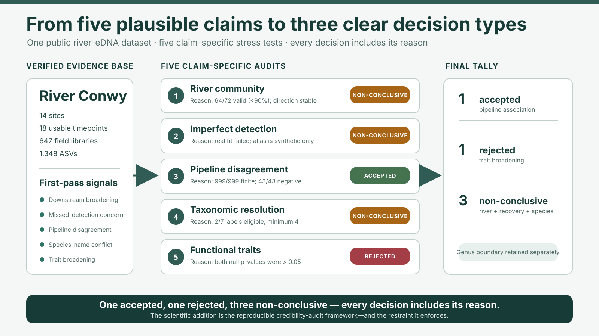

# River Conwy fish-eDNA reanalysis — from eDNA data to a defensible claim

A reproducible reanalysis of the River Conwy 12S fish-eDNA dataset
([Perry et al. 2024, *Nat. Commun.* 15:4372](https://doi.org/10.1038/s41467-024-48640-3)).
It starts from five plausible biological interpretations, tries to falsify each one under
decision rules written down **before** testing, and keeps only the conclusions the evidence
can carry.

| 14 river sites | 18 usable timepoints | 647 validated field libraries | 1,348 sequence variants (ASVs) |
|:-:|:-:|:-:|:-:|



## The question

An eDNA library records DNA molecules recovered from water — not organism abundance, exact
location, true species richness, or necessarily a unique species identity. So the question is
not just *"which fish were detected?"* but:

> **Which biological conclusions stay defensible after correcting the unit of inference,
> testing whether imperfect-detection models can recover known truth, and auditing pipeline,
> taxonomic and trait uncertainty?**

## Approach — three audit layers

- **(E) Community baseline** — compositionally aware community ecology with the biological
  unit and repeated sampling structure handled explicitly.
- **(A) Bayesian site-occupancy** — separates true occupancy from detection probability; used
  here to show what can and cannot be recovered when read depth and biological signal are
  confounded.
- **(B) Reference-database currency** — re-assigns the same sequences against current
  databases and tests which taxonomic ranks stay stable.

## Results — 1 accepted · 1 rejected · 3 non-conclusive

| Claim tested | Verdict | Why |
|---|---|---|
| Pipeline disagreement is associated with source signal | **ACCEPTED** | met every pre-declared stability check (999/999 bootstraps, 43/43 leave-outs); non-causal, not a false-negative rate |
| Functional traits broaden downstream beyond richness | **REJECTED** | fixed-margin trait null not supported (one-sided p = 0.3159) |
| Downstream river community shift | **NON-CONCLUSIVE** | direction stable, but 64/72 analysis families valid (< 90% rule); reference p = 0.0714 |
| Longer mitochondrial markers resolve *Salmo* species | **NON-CONCLUSIVE** | only 2 of 7 candidate labels eligible across 12S, COI and cyt-b; genus is stable, species is not |
| Occupancy model recovers rare-species presence | **NON-CONCLUSIVE** | simulations map design limits (613/1,944 scenarios recoverable); the real model did not converge, so no correction is reported |

The full claim-by-claim record is in [`data/metadata/claim_survival.tsv`](data/metadata/claim_survival.tsv)
and [`docs/phase3-claim-status.md`](docs/phase3-claim-status.md).

> ⚠️ **Data gotcha:** Conwy = site codes **`E01`–`E14`**. The same ENA archive also holds
> **`C##` = a different river**. The download filter and `data/verify_ena_join.py` enforce `E##`.

## Explore it

Clone the repository and open **[`website/index.html`](website/index.html)** in a browser —
a static, offline project website (no server needed). Highlights:

- [`website/research_brief.html`](website/research_brief.html) — six-part, five-minute research brief
- [`website/claim-survival.html`](website/claim-survival.html) — interactive claim-survival map
- [`website/detection-lab.html`](website/detection-lab.html) — imperfect-detection teaching simulator
- [`output/pdf/RESEARCH_BRIEF.pdf`](output/pdf/RESEARCH_BRIEF.pdf) and [`output/pdf/POSTER.pdf`](output/pdf/POSTER.pdf)
- [`report/conwy-reanalysis.qmd`](report/conwy-reanalysis.qmd) — full technical report (Quarto)

**Five-minute reproducibility route** — after the one-time setup in
[START_HERE.md](START_HERE.md):

```bash
python3 scripts/build_website.py     # rebuild figures + PDFs from small inputs
python3 scripts/verify_release.py    # offline release check (links, checksums, claim gates)
```

This does not download FASTQs, run the raw-read pipeline, or run Bayesian MCMC.
`python3 scripts/package_website.py` builds a single portable ZIP of the website
(written to `output/share/`, not committed).

## Status — updated 2026-07-19

- **Phase 0 ✓ — environment and data gates.** The native-arm64 R environment is built and
  **all 21 analysis packages load**; **both** Bayesian
  backends proven end-to-end — Stan (`cmdstanr`) *and* the flagship JAGS/`occumb` chain —
  with auditable receipts in [`docs/smoke_test_receipts.md`](docs/smoke_test_receipts.md).
- ENA metadata verified: **755** Conwy 12S runs, **1:1** ID↔run join, 43 absent cells (a whole
  missing timepoint T16) — [`data/metadata/ena_join_verification.md`](data/metadata/ena_join_verification.md).
- **Published 12S Source Data verified replicate-level** (665 reps × 68 source-study species-label columns) — but it's
  **normalised relative abundance, not counts** ([`source_data_verification.md`](data/metadata/source_data_verification.md)),
  so the fast path is **detection-only**: Phase 1 = `msocc` occupancy; **Layer E + `occumb` move to
  Phase 3 on the reprocessed counts.** Covariate join is **755/755**, BOM-safe
  ([`covariate_join_verification.md`](data/metadata/covariate_join_verification.md) — ⚠️ 3 decision-record covariates
  had gaps, including E14. A flagged, unvalidated E13 donor fills only a supporting climate
  table; climate, flow, and gradient are excluded from the executed headline formula); the T16/usable-occasion NA rule is a
  machine-readable artifact (`data/metadata/occasions.tsv` + `R/lib_design.R`).
- **Phase 1 ✓** single-species `msocc` occupancy on 6 well-detected analysis labels — `R/05_occupancy_msocc.R`.
- **Phase 2 ✓** raw reads → validated ASVs (WSL2 PC): **`seqtab_clean.rds` = 647 libs × 1,348 ASVs, 35.7 M reads**; validation gate **PASS-WITH-CAVEATS** ([`docs/phase2-validation-gate.md`](docs/phase2-validation-gate.md)). Governing caveat: across recovered labels and 642 shared libraries, the pooled detection-cell ratio is ~84% and is associated with the 35-column reprocessed raw-name-table count total and source-study relative abundance. That processed total is not whole-library sequencing depth; it motivated, but did not validate, a detection-model stress test.
- **Phase 3 ✓ — locally complete with a claim demotion.** Layer E community outputs and
  current-resource Layer B concordance are built and audited. Layer B supports stable genus-level
  *Salmo* assignment but not a faithful 2020→2026 replay or a unique species identity; Layer A's failed
  recovery gate is the completed credibility result rather than a corrected occupancy estimate.
- **Layer A remains exploratory.** The current `occumb` tables are smoke-scale diagnostics,
  not production MCMC. The known-truth recovery MCMC failed its convergence gate, so
  **neither its rare-species correction magnitude nor direction is a result**. A separate
  fixed-seed teaching lab illustrates how incomplete adjustment can over-correct under
  confounding without claiming that direction for the Conwy fit. See
  [`docs/phase3-claim-status.md`](docs/phase3-claim-status.md).
- **Phase 5 credibility sprint — local gate outputs complete.** The synthetic-only
  recoverability atlas classifies 613/1,944 estimator–scenario rows as recoverable,
  732 as unreliable, and 599 as non-identifiable; none at baseline per-replicate
  detection `p = 0.20` is recoverable, and both correction estimators are structurally
  non-identifiable at one replicate. This maps design limits and does **not** revive the
  failed real-Conwy Layer-A correction.
- **Four further Phase-5 gates sharpen the biological story.** The *Salmo* species panel
  is coverage-inadequate for MiFish 12S, COI, and cyt-b: 2 of 7 candidate labels are
  eligible, below the required minimum of 4, although the record-level genus boundary
  passes 10/10 queries for every marker. Layer E's full
  robustness gate fails at 64/72 valid families, despite positive direction in 64/64
  valid families and 3,600/3,600 one-library draws with 0/75 leave-out reversals.
  Fixed-margin trait nulls do not support broadening beyond richness/prevalence
  (one-sided `p = 0.3159` primary; `p = 0.1142` strict). By contrast, the scoped
  pipeline-disagreement associations pass: source signal coefficient -1.574
  (bootstrap 95% interval -2.950 to -0.807), and the assigned-fish count total after
  excluding the focal label remains negative at -1.149 (-3.086 to -0.579; 43/43
  leave-outs negative). The preregistered 35-column total includes `Unassigned` and
  the focal count; neither total is whole-library sequencing depth. These are
  source-table-relative, non-causal associations, not biological false-negative rates.
- **Claim-by-claim decision map.** The offline
  [`claim-survival map`](website/claim-survival.html) links each surviving or withheld
  wording to its gate, limitation, next evidence, methods, figure, and
  [machine-readable record](data/metadata/claim_survival.tsv).
- **Local project website release ✓.** `website/index.html` provides the
  scientific summary; `website/research_brief.html` is the canonical self-contained
  research brief; `website/deliverables.html` provides the complete output catalogue;
  the standalone simulator, PDF brief, poster, checked build receipt, and clean-extraction-tested
  sendable ZIP are linked or documented from the local release.
  They present only claims that survived the project's audits and are not a public deployment
  or publication.
- **Synthesis remains local.** The technical report, manuscript draft, and Shiny prototype exist,
  but no public deployment, production occupancy result, or publication is claimed.

> **Compute is two machines.** This Mac (8 GB) runs the light work (Phase 1 `msocc`, Phase 3
> `occumb` + Layer E, Shiny, and writing) and holds the git repo. A **Windows + WSL2 PC
> (64 GB)** runs the RAM-heavy Phase 2 (71 GB download + DADA2) from the USB kit `PS/eDNA/`
> (`README_PC.md` there); small derived `.rds` outputs come back via USB to `data/derived/`.
> The validated hand-back is present, but the complete PC raw-read workflow is not claimed to
> rebuild from a clean clone of this repository.

## Environment (native arm64, isolated)

R lives in a dedicated **conda env `edna`** built with `micromamba` — fully isolated from
any other env (separate root `~/micromamba/envs/edna`). Recreate it:

```bash
micromamba create -y -n edna -f environment.yml      # conda layer (prebuilt arm64 binaries)
micromamba run  -n edna Rscript R/00_setup.R         # CRAN top-ups + 2 source rebuilds + smoke test
```

Run anything in the env with `micromamba run -n edna <cmd>` (e.g. `... Rscript R/04_baseline_E.R`),
or point Positron/VS Code at `~/micromamba/envs/edna/bin/R`. Exact pins: `environment.lock.yml`.
(Two packages — dada2, iNEXT — are built from source by `00_setup.R` because their
osx-arm64 conda builds are broken; see `environment.yml` for why.)

## Data-access and verification helpers

These commands retrieve or verify source material. They are not, by themselves, a complete
clean-clone reproduction of the separate-PC Phase-2 raw-read workflow.

```bash
bash data/download_published.sh        # Perry et al. supplementary files (small; needed for Phase 1)
python3 data/verify_ena_join.py        # Phase-0 gate: 755 Conwy 12S runs, 1:1 join
python3 data/inspect_source_data.py    # P1 gate: replicate-level 12S matrix → fast path viable
python3 data/verify_covariate_join.py  # P3 gate: 755/755 covariate join (BOM-safe) + NA audit
python3 data/build_occasions.py        # P5: emit the occasion/NA map (18 usable timepoints)
bash data/download_ena.sh --dry-run    # preview the ~71 GB FASTQ download (Phase 2)
bash data/download_ena.sh              # actually download raw reads (Phase 2)
```

## Reproducibility boundaries

The conda **`edna`** lockfile pins the Mac R/JAGS/CmdStan analysis environment;
`environment.R-packages.lock.tsv` is the human-readable package record. Reproducibility is
deliberately tiered:

1. **Quick-start capsule:** `python3 scripts/build_website.py` rebuilds the local presentation
   artifacts from small inputs and records a checked receipt.
2. **Phase-5 credibility sprint:** `python3 scripts/run_impact_sprint.py` verifies the
   frozen specification and rebuilds the atlas, benchmark, multiverse, null model,
   pipeline-disagreement analysis, and claim map from their declared local inputs.
3. **Verified analysis hand-back:** Phase-0/1 metadata and the validated Phase-2 derived count
   lineage are present for downstream auditing.
4. **Technical report:** Quarto's committed `freeze: auto` cache preserves the last rendered
   analysis narrative; a full fresh execution also needs the relevant local derived checkpoints.
5. **Raw-read pipeline:** the 71 GB Phase-2 run occurred in a separate WSL2-PC environment. This
   repository does not claim that a clean clone alone reproduces that run end-to-end.

See [`report/_quarto.yml`](report/_quarto.yml) and
[`START_HERE.md`](START_HERE.md) for the two different reproducibility scopes.

## Layout

```
website/ local static project website, complete deliverables catalogue, simulator, figures, and build receipt
output/pdf/   research brief + poster PDFs
data/   download helpers + ENA metadata + derived join/count tables + data dictionary
R/      setup, design tests, 01_qc_cutadapt … 10_sim_recovery  (pipeline/audit stages)
stan/   reserved for optional dynamic occupancy; no model is implemented
report/ technical Quarto report + committed freeze cache
shiny/  exploratory local occupancy/reclassification app
docs/   analysis-decision record, validation, claim-status, and supporting notes
figures/
```

## Credits

- **Source study and data:** Perry, W. B. *et al.* (2024). *An integrated spatio-temporal view
  of riverine biodiversity using environmental DNA metabarcoding.* Nature Communications 15,
  4372. [doi:10.1038/s41467-024-48640-3](https://doi.org/10.1038/s41467-024-48640-3) (CC BY 4.0).
  Raw reads: ENA [PRJEB48362](https://www.ebi.ac.uk/ena/browser/view/PRJEB48362).
- **AI assistance:** developed with help from Claude (Anthropic), used through Claude Code for
  code, analysis scaffolding, auditing and documentation.
- **Open-source software:** R, DADA2, cutadapt, decontam, occumb, msocc, JAGS, Stan/cmdstanr,
  Quarto, Shiny, and the Python packages pinned in `requirements-website.txt`.

## License

All rights reserved — see [`LICENSE`](LICENSE). Third-party material keeps its own terms.
Citation metadata: [`CITATION.cff`](CITATION.cff). This reanalysis has not been published.
