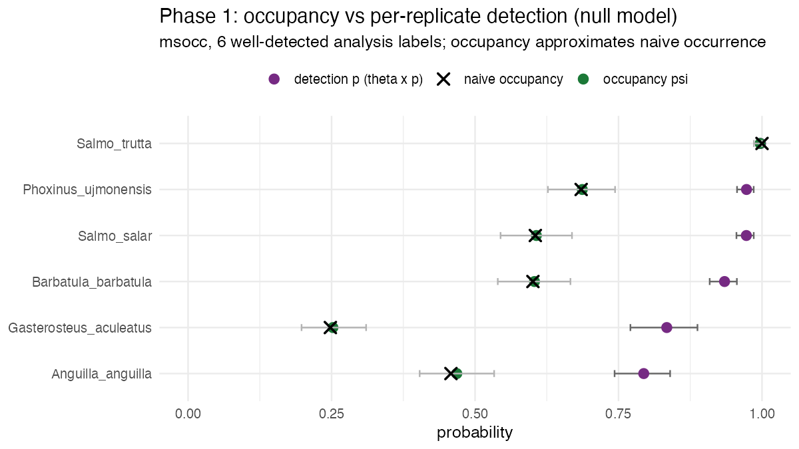
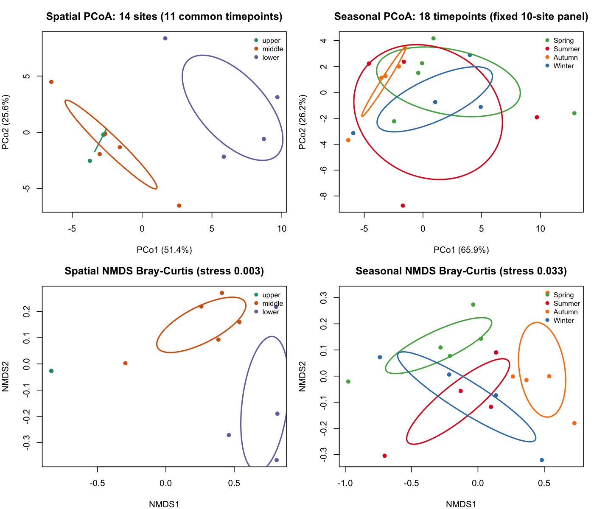
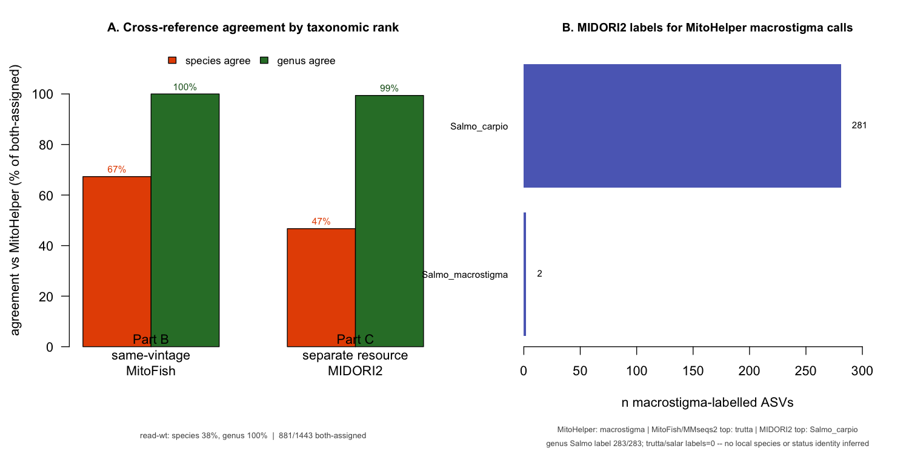
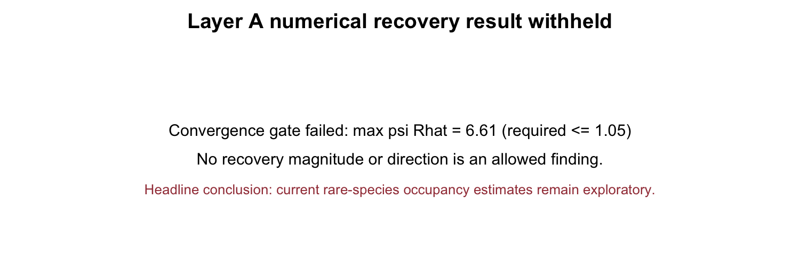
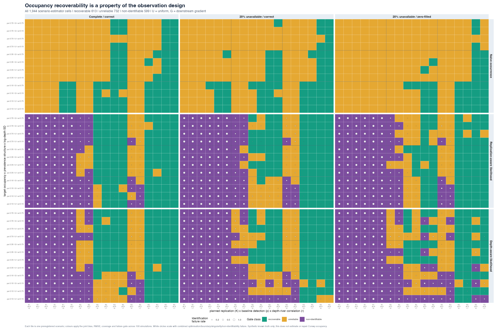
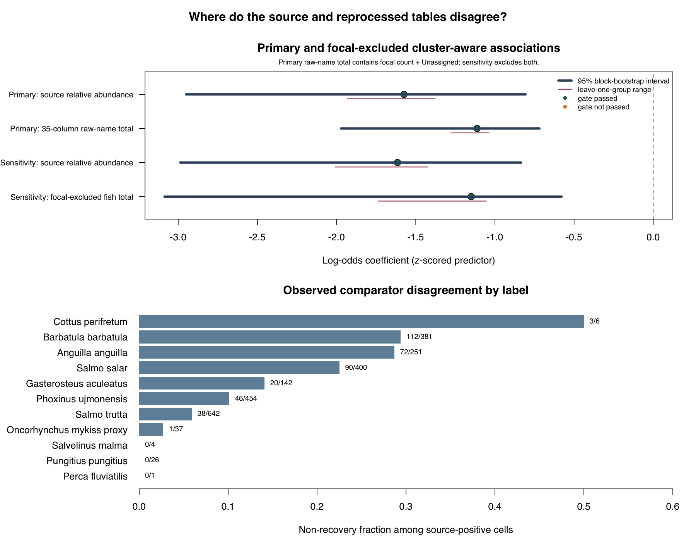
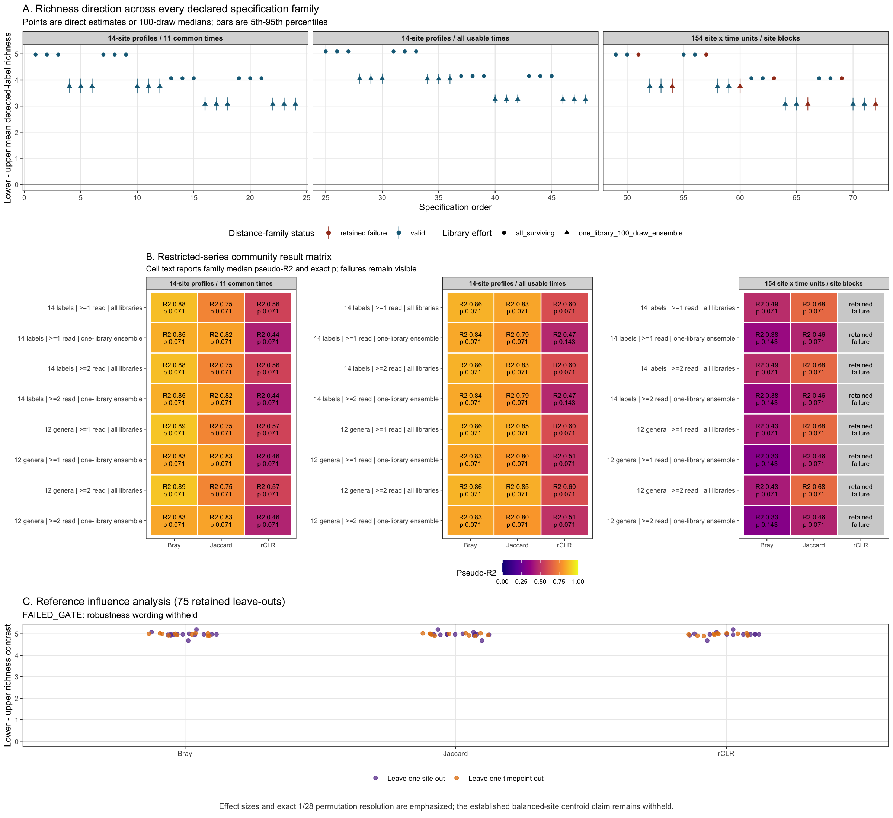
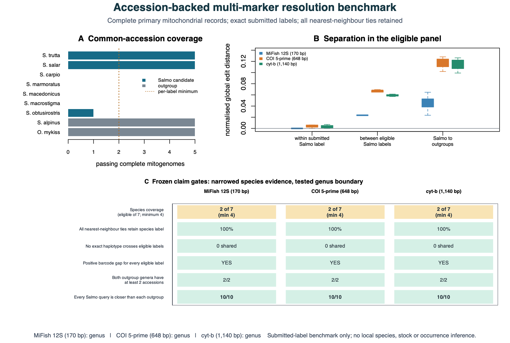
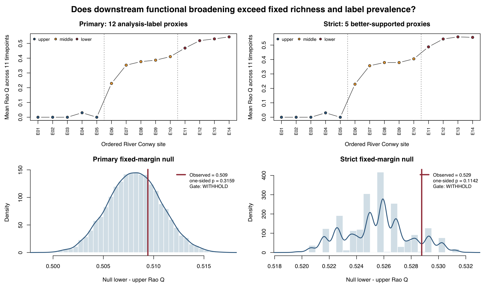

## Overview

This report is the technical record for the completed setup, single-species
occupancy, raw-read validation, community baseline, database comparison, the
exploratory community-occupancy stress test, and the Phase-5 credibility sprint.
It reads cached local Phase-3 and Phase-5 summary
tables; it does **not** claim that a clean clone can regenerate the 71 GB raw-read
pipeline or the smoke-scale MCMC. The small quick-start capsule is independently
reproducible with `python3 scripts/build_website.py`.

> Status (2026-07-19): **Phases 0–2 complete** · **Phase 3 analyses executed and
> scientifically hardened** · **local portfolio edition built** · publication,
> deployment, and production MCMC deliberately not required. Phase-1 occupancy/detection
> estimates for six well-detected analysis labels are validated; Phase-3 sparse-label occupancy remains an exploratory
> stress test, not a biological estimate. Phase 5 adds synthetic/design and
> comparator-relative audits; it does not promote that real-data correction.

```{r setup}
#| include: false
# Render inside the env:  micromamba run -n edna quarto render report/conwy-reanalysis.qmd
knitr::opts_chunk$set(echo = FALSE, message = FALSE, warning = FALSE)
root <- { cc <- c(".", "..", "../.."); cc[file.exists(file.path(cc, "R/05_occupancy_msocc.R"))][1] }
# sources R/05: loads the cached MCMC fits (or computes them once), leaving `res` in scope
suppressMessages(suppressWarnings(source(file.path(root, "R/05_occupancy_msocc.R"))))
suppressPackageStartupMessages({ library(dplyr); library(knitr); library(ggplot2) })
est <- res$estimates
cn  <- res$counts
pull1 <- function(sp, col, m = "null") est[[col]][est$species == sp & est$model == m]
```

## Phase 0 — data provenance & verification

ENA **PRJEB48362**, Conwy 12S (`E01`–`E14`); the join is strict 1:1 (755 runs),
covariates 755/755, and the occasion map (`occasions.tsv`) encodes the two levels
of structured missingness used below. See `data/metadata/*_verification.md`.

## Phase 1 — single-species occupancy (`msocc`)

### 1. Detection histories (validated)

Built from the published, replicate-level 12S matrix
(`source_data_12S_normalised.tsv`; detection = relative abundance > 0). Each
**site × timepoint** is an occupancy unit; the **3 water-sample replicates** are
the detection replicates. The single source of truth for missingness is
`R/lib_design.R::observable_mask("published")`, against which the input rows are
checked for exact equality before anything is fitted.

```{r counts}
tibble::tibble(
  Quantity = c("Observable cells (published, QC-passed)",
               "→ QC-dropped cells (NA, never 0)",
               "→ unsurveyed cells incl. all of T16 (NA, never 0)",
               "Occupancy units with ≥1 observation",
               "  ↳ of which have <3 observed replicates (ragged)",
               "Species: raw → after authors' cleaning"),
  Value = c(cn$observable, cn$dropped_qc, cn$unsurveyed,
            sprintf("%d (of 252 theoretical = 14×18; %d units lost all reps to QC)",
                    cn$units, 252 - cn$units),
            cn$units_lt3reps,
            paste(cn$n_species_raw, "→", cn$n_species_clean))
) |> kable()
```

**NA-not-0 is the point of the exercise.** A site×time whose 3 replicates all
failed QC, or the never-sampled timepoint **T16**, must be *unknown* — not a
string of false zeros that would drag occupancy ψ downward (the exact bias this
project exists to expose). Here that is enforced by *inclusion*: only the
observable cells become model rows; everything else contributes no likelihood.

**Cleaning** follows the authors (`Analysing_BLAST_output_WP2_12S.R` ~355–368):
drop the `Scomber_scombrus` positive-control spike and the marine/aquaculture
strays, and lump 3 database misassignments (`Salmo_obtusirostris`→`Salmo_trutta`;
`Anguilla_rostrata`→`Anguilla_anguilla`;
`Salvelinus_fontinalis_x_Salvelinus_malma`→`Salvelinus_malma`).

### 2. The model (2-level occupancy via `msocc`)

`msocc` is a 3-level sampler (site → sample → PCR rep). The source study's PCR triplicates were
pooled before indexing, so each water sample gives **one** call. To keep
occupancy identifiable, the 3 water samples enter at the **sample (θ)** level
(not the rep level): the fitted model is the canonical single-season occupancy
model `y_ij ~ Bernoulli(z_i · θ_ij · p)`, `z_i ~ Bernoulli(ψ_i)`. With one call
per sample, θ and p are not separately identified, so the **per-replicate
detection probability is reported as the product θ·p**. *(See "Deviations from
Phase 1" in `eDNAplan.md` for the identifiability argument.)*

Covariates complete across all 14 sites: occupancy ψ ~ `Dist_from_lake` (z) +
`season`; detection ~ z-scored `log(read depth)`. *(Flow is dropped from Phase 1:
the only complete flow column, `Catchment_flow_m3_s`, is a catchment-wide series
identical across all 14 sites — it varies only over time, so it carries no spatial
signal for ψ; the spatially-resolved flow family is 100% NA for E13/E14.
	`river_gradient` was historically deferred. In the executed Phase-3 headline formula,
	flow and gradient are excluded; `Dist_from_lake + season` is used instead.)*

### 3. First ψ-vs-p estimates

`r length(res$selected)` well-detected analysis labels (≥30 units), null model — occupancy
ψ and per-replicate detection θ·p (posterior mean, 95% CrI), against naïve
occupancy (fraction of units with any detection):

```{r est-table}
est |> filter(model == "null") |>
  transmute(`Analysis label` = species,
            `Units det.` = units_detected,
            `Naïve occ.` = round(naive_occ, 3),
            `ψ (occupancy)` = sprintf("%.2f [%.2f, %.2f]", psi, psi_l, psi_u),
            `θ·p (detection)` = sprintf("%.2f [%.2f, %.2f]", p, p_l, p_u),
            `P(miss at 3 reps)*` = round(fn_rate3, 3)) |>
  kable(align = "lrrllr",
        caption = sprintf("*Forward-looking miss probability AT the design effort of 3 replicates, (1−θ·p)³ — a power statement, not the realized rate: %d of %d units have <3 observed reps, where realized miss is higher.", cn$units_lt3reps, cn$units))
```



### 4. Interpretation — first Bayesian intuition (and an honest result)

- **Occupancy ≠ detection.** `ψ` is the probability a species *is present* at a
  site×time; `θ·p` is the probability a single water sample *catches* it when it
  is present. The whole point of the model is to estimate them separately.
- **For these well-detected analysis labels the correction is small — and that is a real
  finding, not a failure.** Occupancy `ψ` comes out ≈ naïve occupancy
  (the `×` and the green `ψ` nearly coincide), because detection-given-presence is
  high: `θ·p` is `r sprintf("%.2f", min(est$p[est$model=="null"]))`–`r sprintf("%.2f", max(est$p[est$model=="null"]))`
  per replicate. The raw data show why — when present, these labels are detected in
  ~all 3 water samples (mean 2.3–2.8 of 3). So the chance an occupied unit is
  missed by *all three* replicates, `(1 − θ·p)³`, is only
  `r sprintf("%.0f", 100*min(est$fn_rate3[est$model=="null"]))`–`r sprintf("%.0f%%", 100*max(est$fn_rate3[est$model=="null"]))`
  *at the nominal 3-replicate effort*. So the 3-replicate design is **well-powered
  for this selected label set** (the `r cn$units_lt3reps` of `r cn$units` units with <3 usable
  reps miss somewhat more often — the realized rate exceeds this design-effort value).
- **This does *not* vindicate the published absences in general.** False-negative
  risk is largest exactly where detection is low — the sparsely detected analysis labels,
  which single-species `msocc` cannot fit reliably (too few detections to separate
  ψ from p). That motivated the Phase-3 community-model stress test. Its recovery
  MCMC failed convergence, so rare-taxon numerical panels and survey-design output
  are suppressed rather than presented as results.
- **The method does find hidden occupancy when it is there.** The mapping check
  (`R/test_msocc_mapping.R`) simulates a genuinely imperfect process
  (ψ = 0.60, detection = 0.40) and recovers ψ̂ ≈ 0.57 **above** the naïve 0.42 —
  so the small corrections here reflect the *data* (the selected labels are easy to
  detect), not a model that cannot see false negatives.
- **Covariate models suggest spatial and seasonal structure.** Adding `Dist_from_lake` +
  `season` to ψ lowers the single-chain exploratory WAIC for every selected label except the saturated
  `Salmo_trutta` (e.g. `Phoxinus` `r round(pull1("Phoxinus_ujmonensis","waic","null"))` →
  `r round(pull1("Phoxinus_ujmonensis","waic","occ"))`; table below). The fitted
  per-unit ψ values vary along the river and across seasons even though the average is
  unchanged, but these covariate-level effects remain preliminary. (The single averaged ψ in
  the results table is a finite-population mean, so its CI is *not* comparable to
  the null intercept's.) Adding read depth to detection barely moves WAIC
  (`r round(pull1("Phoxinus_ujmonensis","waic","occ"))` →
  `r round(pull1("Phoxinus_ujmonensis","waic","occ_det"))`): detection is already
  near its ceiling for these selected labels, so sequencing depth explains little.
- **Convergence (honest caveat).** The headline null-model ψ / θ·p chains mix well
  — effective sample sizes run into the thousands for the five non-saturated
  analysis labels; the boundary case `Salmo_trutta` (ψ ≈ 1) is the low exception at ≈
  `r round(min(est$min_ess_psi[est$model=="null"], na.rm=TRUE))`, immaterial since
  its ψ is pinned near 1. In the *covariate* models a few near-separated `season`
  coefficients mix slowly (min ESS ≈
  `r round(min(est$min_ess_psi[est$model!="null"], na.rm=TRUE))` over 10,000 draws,
  `posterior::ess_basic`), so those covariate-level effects are **preliminary** —
  the large ΔWAIC values suggest the ranking, but individual season coefficients are
  under-sampled. This is a single seed-fixed chain; those covariate effects remain
  preliminary and are not used in the headline conclusions. None of this touches
  the descriptive ψ-vs-detection comparison for the six selected analysis labels.
- **The saturated case.** `Salmo_trutta` is detected in every unit and nearly
  every replicate, so ψ → 1 and detection → 1; it bounds the panel and shows what
  *near-certain* occupancy looks like (and why its covariate coefficients are only
  weakly identified — no zeros to learn from).

```{r waic}
#| eval: true
wt <- est |> select(species, model, waic) |>
  tidyr::pivot_wider(names_from = model, values_from = waic)
if (all(is.na(unlist(wt[-1])))) cat("WAIC not available for this msocc build.\n") else
  wt |> mutate(across(where(is.numeric), ~round(., 1))) |>
  kable(caption = "WAIC by model (lower = better): null vs +occupancy covariates vs +detection covariate.")
```

> **Honest scope.** Single-label `msocc` on a handful of analysis labels is a learning
> and validation step. Phase 3 tested a read-count community model on the
> reprocessed counts, but its rare-species estimates failed the project's own
> recoverability gate and remain exploratory.

## Phase 2 — reprocessing to a validated ASV count table

Raw 12S reads were reprocessed on the 64 GB WSL2 PC (cutadapt → DADA2 → decontam)
to a taxonomy-agnostic **ASV count table**, `seqtab_clean` = **647 libraries ×
1,348 ASVs, 35.7 M reads** (survival 647/755 vs the authors' 665/755). Because the
published table is *normalised* relative abundance, this reprocessed count table is
what unlocks the count-based baseline (E) and the read-count occupancy model (A). A
consensus crosswalk bridges the 2020↔2025 database name vintages before the
reprocessed detections are compared to the published table over the shared replicates:

```{r phase2}
d <- file.path(root, "data/derived")
cs <- read.delim(file.path(d, "concordance_summary.tsv"), check.names = FALSE)
g <- function(k) cs$value[cs$metric == k]
tibble::tibble(
  Metric = c("Shared replicates", "Source-study taxa detectable there",
             "Taxon-label recovery (species)", "Taxon-label recovery (genus)",
             "Read-weighted Bray–Curtis similarity", "Cosine similarity",
             "Cell precision", "Cell recall"),
  Value  = c(g("shared_replicates"), g("authors_taxa_detected_in642"),
             sprintf("%.0f%%", 100 * as.numeric(g("species_recovery_permissive"))),
             sprintf("%.0f%%", 100 * as.numeric(g("genus_recovery"))),
             g("braycurtis_mean"), g("cosine_mean"),
             g("cell_precision"), g("cell_recall"))
) |> kable(caption = "Validation gate — concordance, not exact match (DADA2 version drift makes counts loose targets).")
```

**PASS-WITH-CAVEATS.** Every taxon the authors saw in ≥3 replicates is recovered;
precision is 0.99 (little over-calling). The
**governing caveat** is a **~16% pooled detection-cell deficit across the recovered label set**
(cell recall ≈ 0.84 over 642 shared libraries),
associated with a 35-column reprocessed raw-name-table count total and low source-study
relative abundance—which co-vary with the upstream-to-downstream biological-signal gradient.
That processed total is not whole-library sequencing depth. It motivated separately testing
whole-library read depth on detection in Layer A; the recovery study below shows why including that
term is a hypothesis to test, not a guaranteed correction.

## Phase 3 — community baseline (E), occupancy (A), reclassification (B)

### Layer E — compositionally-correct community baseline

Replicate libraries are first summed to **234 site × timepoint biological units**.
For spatial inference, the 11 timepoints observed at every site are collapsed to
14 site profiles; for seasonal inference, the 10 sites observed at every usable
timepoint are collapsed to 18 timepoint profiles. P-values use the complete cyclic
and mirrored river-order or chronological series (27 spatial; 35 temporal), rather
than treating hundreds of water libraries as exchangeable biological replicates.

Across all 234 realized site-time units, the descriptive detected-label richness
median rises from one label at E01–E05 to seven at E14. This all-unit summary retains
unequal timepoint availability and 1–3 libraries per unit; the website hero therefore
uses the 11 timepoints shared by every site, which preserves the endpoints and changes
only E10's median from 4.5 to 4.0. Under the restricted inferential design,
however, no section or season PERMANOVA reaches 0.05 (section p = 0.0714 for all
three distances; season p = 0.333–0.778). Two unadjusted restricted-series section
PERMDISP sensitivities give p = 0.0357 for Bray–Curtis and robust Aitchison, but
Jaccard does not; no seasonal dispersion contrast reaches 0.05. The defensible
conclusion is therefore **descriptive downstream broadening plus an exploratory
dispersion signal**, not a confirmed
section centroid shift.

```{r layerE-permanova}
pm <- read.delim(file.path(d, "layerE_permanova.tsv"), check.names = FALSE)
pm[pm$term == "location", c("distance", "grouping", "Df", "R2", "F", "p_value")] |>
  kable(row.names = FALSE, caption = "Restricted-series PERMANOVA on 14 site or 18 timepoint profiles. Large R2 values are not treated as confirmed effects when exact p-values exceed 0.05.")
```

Two taxa meet the original ≥2-of-3 package-consensus DA rule, but neither survives
the added site-level restricted-series BH gate; therefore **zero taxa are reported
as supported differential-abundance hits**. No indicator reaches p ≤ 0.05 under
the same restricted spatial permutations (the smallest p is 0.077):

```{r layerE-indic}
ind <- read.delim(file.path(d, "layerE_indicator_species.tsv"), check.names = FALSE)
ind[order(-ind$IndVal_stat), ] |> head(10) |>
  transmute(Species = gsub("_", " ", species), Section = section_group,
            IndVal = round(IndVal_stat, 3), p = p_value) |>
  kable(row.names = FALSE, caption = "Exploratory site-level IndVal.g screen; no restricted-series p-value is ≤ 0.05.")
```



### Layer B — reference-database currency

In the 647-field-library count table, MitoHelper Nov-2025 assigns 838/1,348 ASVs
(62.2%) and 94.1% of reads. The broader 1,443-ASV field+control classification
universe contains 886 assigned ASVs (61.4%) and 93.3% assigned reads. The dominant
local first-hit label is reference-dependent: *Salmo macrostigma* accounts for 46.0%
of all field reads (48.8% of assigned field reads; ASV0001 alone is 39.5% of the
field table), but a literal local interpretation is unsupported. Re-classifying
the same ASVs against an independent reference resource (MIDORI2 GenBank271) shows
that the *Salmo* **species** label is reference-dependent while **genus is stable**:

```{r layerB-indep}
s <- read.delim(file.path(d, "reclassB_indepDB_summary.tsv"), check.names = FALSE)
gv <- function(k) s$value[s$metric == k]
tibble::tibble(
  Metric = c("Independent DB", "ASVs compared (both assigned)", "Genus agreement",
             "Species agreement", "ASV0001 — MitoHelper call", "ASV0001 — MIDORI2 call"),
  Value  = c("MIDORI2 GenBank271 (12S srRNA)", gv("n_both_assigned"),
             paste0(gv("pct_genus_agree_of_both"), "%"), paste0(gv("pct_species_agree_of_both"), "%"),
             gsub("_", " ", gv("asv0001_taxonomy")), gsub("_", " ", gv("asv0001_indepDB")))
) |> kable()
```

Across three comparisons spanning two current reference resources, the same dominant
sequence is called *S. macrostigma* / *S. trutta* / *S. carpio* — genus *Salmo*
throughout. A direct current public-record witness set goes further: one exact 170-bp
haplotype carries at least five *Salmo* species labels. **The molecular evidence is
therefore stable at genus, not species.** See `docs/salmo_molecular_detective_methods.md`
for accessions, alignment, distance network, and limits.



### Layer A — community occupancy (`occumb`)

Read-count community occupancy was fitted with a read-depth detection term and
structural-NA coding for unobserved cells. The result is retained as an
**exploratory model stress test only**. The short smoke fit generated unstable
rare-taxon adjustments, but its known-truth recovery MCMC failed the convergence
gate. Neither adjustment magnitude nor direction is a recovered result, and none
is used in the headline biological conclusions. In addition, 18 observed
libraries have all-zero vectors in the 14-taxon harmonised input: `occumb` drops
those vectors while the naïve comparator counts them as non-detections. That
observation-mask/comparator mismatch reinforces the demotion.

The cached corrected-vs-naïve table, coefficient panels, false-negative panel, and
survey-utility curve are therefore **suppressed in this release**. The five underlying
figure paths are replaced by claim-gate cards so that an old link cannot present the
smoke estimates without their failed-recovery status. What remains defensible is
narrower: Phase-1 detectability for the six selected analysis labels, evidence that the current Layer-A
workflow cannot support rare-species claims, and the need for independent replication
in a redesigned survey. Longer chains can reduce Monte Carlo error but cannot identify
why a zero occurred when depth and biology share a gradient or repair a mismatched
comparison set.

```{r layerA-recovery}
rs <- read.delim(file.path(root, "data/metadata/layerA_recovery_status.tsv"), check.names = FALSE)
rs[, c("analysis", "fit_scale", "max_psi_Rhat", "convergence_threshold",
       "convergence_pass", "claim_status", "allowed_claim")] |>
  kable(row.names = FALSE, digits = 3,
        caption = "Layer A recovery gate. Numerical recovery direction/magnitude is suppressed when convergence fails.")
```



## Phase 5 — credibility sprint and claim survival

The Phase-5 analyses were [frozen locally before their new
runs](../docs/impact-sprint-preregistration.md). Their deterministic rebuild entry point is:

```bash
python3 scripts/run_impact_sprint.py
```

The governing reader-facing record is the offline
[claim-survival map](../website/claim-survival.html); its
[machine-readable source](../data/metadata/claim_survival.tsv) links every initial claim
to its gate, surviving wording, limitation, next evidence, method, and figure.

### Synthetic occupancy recoverability atlas

The frozen 648-scenario grid crossed known occupancy and detection conditions with
three estimators (1,944 estimator–scenario rows). It classifies **613 as recoverable,
732 as unreliable, and 599 as non-identifiable**. At baseline per-replicate detection
`p = 0.20`, none of the 648 estimator–scenario rows is recoverable. With one replicate,
both correction estimators are structurally non-identifiable in all 216 applicable
rows each; the separately scored naïve occurrence estimator is not a correction.
These are synthetic known-truth design results, not estimates for River Conwy. They
neither repair the real observation mask nor revive the unconverged Layer-A correction
([methods](../docs/impact_occupancy_atlas_methods.md)).

{fig-alt="Phase diagram classifying 1,944 synthetic occupancy estimator-scenarios as recoverable, unreliable, or non-identifiable across detection, replication, depth coupling, missingness and mask error."}

### Cluster-aware pipeline disagreement

The exact denominator is **2,344 source-positive cells** in 642 shared libraries;
1,962 are recovered and 382 are source-positive/reprocessed-negative. In the
preregistered primary logistic model, the standardized source-signal coefficient is
**-1.574** (cluster-aware bootstrap 95% interval **-2.950 to -0.807**) and the
preregistered 35-column raw-name-total coefficient is **-1.112** (**-1.972 to
-0.719**). That total includes `Unassigned` and the focal count, creating direct
part-whole coupling with non-recovery, so it is retained as an audit rather than used
alone. In the paired focal-excluded sensitivity, the assigned-fish count-total
coefficient remains **-1.149** (**-3.086 to -0.579**): all 999 bootstrap fits are
finite and all **43/43** taxon/site/time leave-outs remain negative. The association
gate therefore passes after removing the focal term. Neither processed total is
whole-library sequencing depth, the response is source-table-relative non-recovery,
and neither pipeline is biological ground truth; these are not causal effects,
biological false-negative rates or abundance effects
([methods](../docs/impact_pipeline_disagreement_methods.md)).

{fig-alt="Cluster-aware coefficient intervals and comparator non-recovery fractions by harmonised analysis label."}

### Layer-E robustness multiverse

The full robustness gate **fails** because **64/72** specification families are valid
(88.9%, below the frozen 90% threshold); the eight invalid rCLR families encounter
genuinely empty communities in the real balanced panel. Direction nevertheless stays
positive in **64/64 valid families** and **3,600/3,600** declared one-library draws,
and **0/75** reference leave-outs reverse it. This supports only a highly stable
descriptive direction. It does not pass the full robustness label, establish a causal
gradient, or change the restricted reference PERMANOVA result (`p = 2/28 = 0.0714`)
([methods](../docs/impact_layerE_multiverse_methods.md)).

{fig-alt="Complete Layer-E specification curve and influence view retaining valid, failed and directionally stable multiverse results."}

### Accession-backed *Salmo* multi-marker benchmark

For MiFish 12S, 5-prime COI, and cyt-b, only **2 of 7 candidate *Salmo* labels**
pass the frozen accession-coverage rule; the minimum is 4, so the species panel is coverage-inadequate
for every marker. The narrowed two-label submitted-name comparison scores 10/10, but
cannot be promoted through that failed coverage gate. The genus boundary does pass:
for each marker, all **10/10** *Salmo* queries are nearer to *Salmo* than to each of the
two outgroup genera. Submitted public-record names remain annotations, not verified
truth. Seven of 21 records—including all five *S. salar* records—lack specimen-level
source keys, so biological independence is unverified. This benchmark establishes neither ASV0001 species identity nor local
occurrence, ancestry, stock, hybrid status, or abundance
([methods](../docs/impact_salmo_multimarker_methods.md)).

{fig-alt="Accession coverage, marker distances and frozen species/genus gates for MiFish 12S, COI and cyt-b."}

### Functional-trait fixed-margin null

The one-sided gate fails in both declared panels: primary 12-label `p = 0.3159` and
strict five-label `p = 0.1142`, each from 9,999 fixed-margin draws. Both observed
downstream Rao-Q contrasts are slightly above their null means, but neither is
unusually large under the fixed-margin null. Descriptive trait
patterns may still be shown conditionally, but a beyond-richness/prevalence mechanism
is withheld ([methods](../docs/impact_trait_null_methods.md)).

{fig-alt="Observed downstream Rao trait diversity and fixed-margin null distributions for primary and strict analysis-label panels."}

## Limitations vs MIEM

- **Reads ≠ abundance.** All community and occupancy inference is framed as
  *occurrence/detection*, never biomass.
- **Non-detection ≠ absence.** Phase 1 estimates detection for six well-detected analysis labels. The
  Phase-2 ~16% pooled detection-cell deficit across recovered labels and 642
  shared libraries is associated with a reprocessed raw-name-table count total and
  source-study relative abundance; that total is not whole-library sequencing depth. The exploratory
  community model cannot reliably disentangle those mechanisms for rare taxa. Its
  recovery MCMC also fails convergence, so no numerical direction is retained. The
  separate deterministic teaching lab is a teaching counterexample, not a calibration
  certificate for Layer A.
- **Reference-database currency** is Layer B's explicit subject: the *S. trutta*-complex
  species label is database-dependent (genus-only reliable), and the 2020 MitoFish build
  is unarchived, so Layer B is 2026 concordance, not a 2020→2026 replay.
- **Phase-5 audit scope is deliberately narrower than biological truth.** The occupancy
  atlas is synthetic; pipeline disagreement is comparator-relative; accession names are
  submitted annotations; the Layer-E multiverse misses its complete gate; and the trait
  null rejects the proposed beyond-richness interpretation.
- **eDNA transport:** detection location ≠ organism location (authors' ≤5 km bound).
- **Marker + covariate limits:** 12S-MiFish under-resolves lamprey and flounder. Source
  E14 climate and gradient values are absent; a flagged E13 donor exists only in a
  supporting table, is not validated as an E14 measurement, and is excluded together
  with climate and gradient from the executed headline formula.

## Portfolio edition

The locally complete, production-MCMC-independent route starts at
`website/index.html`. Its four-page visual brief with five model architecture diagrams, standalone synthetic lab, poster,
and under-five-minute figure build all preserve the claim boundary above.
