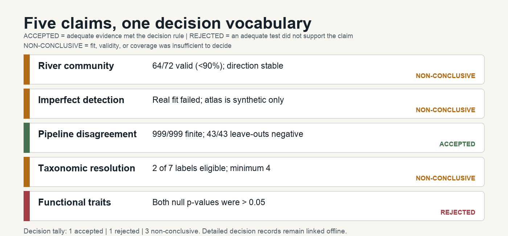

<a class="skip-link" href="#our-question">Skip to the research brief</a>

Research brief · reproducible computational biology

# From fish-eDNA data to a defensible scientific claim

A River Conwy reanalysis that began with five plausible interpretations, tried to falsify each one, and retained only the conclusions their evidence could carry.

:::: {.project-facts}
::: {.fact}
**14**

river sites
:::
::: {.fact}
**18**

usable timepoints
:::
::: {.fact}
**647**

validated field libraries
:::
::: {.fact}
**1,348**

amplicon sequence variants
:::
::::

**Decision key:** **ACCEPTED** means the initial claim met its predeclared decision rule; **REJECTED** means an adequate test did not support it; **NON-CONCLUSIVE** means the current data or model could not decide it.

**Final tally:** **1 ACCEPTED · 1 REJECTED · 3 NON-CONCLUSIVE.**

## 1. Our question {#our-question}

An eDNA library records molecules recovered from water. It does not directly record organism abundance, exact location, true species richness, or necessarily a unique species identity. Our question was therefore not simply “what fish were detected?” but:

**Which biological conclusions remain defensible after correcting the unit of inference, testing whether imperfect-detection corrections can recover truth, and auditing pipeline, taxonomic and trait uncertainty?**

The source study supplied the River Conwy samples, reads, published matrix, covariates and original methods. This project added a reproducible reanalysis and credibility-audit layer. It separates **observed evidence** from the three claim decisions: **ACCEPTED**, **REJECTED** and **NON-CONCLUSIVE**.

The first-pass reanalysis found three reasons for caution: the downstream river pattern was descriptive rather than a confirmed section shift (**p = 0.0714**); the same exact **170-bp** sequence received several *Salmo* species labels while retaining the same genus; and the real sparse-label recovery claim was **NON-CONCLUSIVE because the model did not converge** (internal audit code: **`WITHHELD_UNCONVERGED`**) rather than reported as a biological estimate. [Read the first claim record](../docs/phase3-claim-status.md).

## 2. Our methodology + key research documentation moments

The workflow treated documentation as part of the science. We confirmed what had actually been sampled, reprocessed the raw DNA reads, recorded a model that could not support an estimate, wrote the five stress-test rules before running them, and then reran the workflow to check that the results were reproducible.

![Five-step methodology timeline. First, confirm the River Conwy source records, repeated samples and missing-data rules. Second, reprocess the DNA reads into 647 validated field libraries and 1,348 DNA sequence variants. Third, record that the rare-label model did not converge and therefore could not support an occupancy estimate. Fourth, write the five questions, exact settings, included runs and verdict rules before testing. Fifth, run the full analysis twice and check a clean offline copy for matching, working outputs.](assets/research-timeline.png)

| Evidence layer | Biological or comparison unit | Main method | Claim-control principle |
|---|---|---|---|
| **River community** | Site × timepoint, not individual libraries | Restricted-series PERMANOVA and a 72-family multiverse | Preserve repeated structure and every invalid specification |
| **Imperfect detection** | Site × timepoint with replicate observations; synthetic known truth for recovery | Common-label occupancy/detection models plus a factorial recovery atlas | Demonstrate recovery before interpreting a correction |
| **Pipeline disagreement** | Exactly 2,344 source-positive cells, clustered by taxon, site and time | Logistic model, paired block bootstrap and leave-outs | Treat neither pipeline as biological truth |
| **Taxonomy and traits** | Accession × marker records; site-time occurrence matrices | Sequence distances/classification; Gower–Rao fixed-margin null | Separate database labels and trait proxies from verified biology |

Key documentation moments were:

1. **Check the source data.** We confirmed that the records belonged to the River Conwy, linked repeated water samples, and marked observations that were missing by design before analysis.
2. **Reprocess the DNA reads.** Running the raw sequencing workflow produced 647 validated field libraries and 1,348 unique DNA sequence variants (ASVs); comparison with 642 shared libraries met the validation requirements with documented caveats. [Phase-2 validation record](../docs/phase2-validation-gate.md).
3. **Record model limits.** The rare-label recovery model did not converge and 18 libraries had inconsistent missing-data rules, so it could not support a biological occupancy estimate and the claim remained **NON-CONCLUSIVE**.
4. **Set the tests in advance.** A [dated analysis plan stored with the project](../docs/impact-sprint-preregistration.md) recorded the five questions, what each test would estimate, the exact repeatable settings, which results would count, the exclusions, and the verdict rules before the new stress tests began. This was not an external registration.
5. **Confirm reproducibility.** The [claim-survival register](../data/metadata/claim_survival.tsv) linked every starting claim to its evidence, limitation and final wording. We ran the full workflow twice from the committed files, matched the outputs, and checked that a clean offline copy opened with working links.

## 3. Our initial claims from the first part of the project

These were **candidate claims formulated by this reanalysis after the first analytical phase**. They are not claims attributed to the source-study authors. Each was scientifically plausible, but each could also be wrong for a different reason.

| No. | Our initial claim | Why it required a stronger test |
|---:|---|---|
| **1** | Detected fish analysis-label richness broadens downstream in a robust way. | The direction could depend on effort, aggregation, taxonomy, distance choice or a small number of sites/timepoints. |
| **2** | A correction model can recover the true occupancy of rare Conwy labels. | Low detection, one replicate, depth–river coupling, missingness and incorrect missing-data coding can make occupancy non-identifiable. |
| **3** | Lower source signal or a lower processed fish count total predicts pipeline non-recovery. | Taxon, site and time observations are dependent, and the original count total contained the focal label itself. |
| **4** | Longer mitochondrial markers resolve the relevant public *Salmo* species labels more finely than MiFish 12S. | Apparent performance can be created by sparse label coverage, duplicated specimens or submitted database names treated as truth. |
| **5** | Downstream functional-trait diversity broadens more than expected from richness and prevalence alone. | Detecting more labels automatically creates more possible trait combinations, even without a distinct ecological mechanism. |

## 4. Stressing those claims with more tests

The second phase did not search for the most favourable specification. It applied a decision rule written before testing and kept non-converged fits, invalid distance calculations, and inadequate reference coverage in the reported totals rather than quietly removing them.

| Claim | What we tested it against | Result | Verdict |
|---|---|---|---|
| **River community** | 72 analysis families varying panel, unit, taxonomy, detection threshold, effort handling and distance; 3,600 equal-effort draws and 75 leave-outs | **64/72** families valid (88.9%, below the 90% rule); 64/64 valid directions and 3,600/3,600 draws positive; 0/75 reversals | **NON-CONCLUSIVE —** the direction was stable, but validity missed the declared threshold and the reference p-value was 0.0714 |
| **Imperfect detection** | 648 known-truth scenarios × 100 simulations × three estimators under detection, replication, depth coupling, missingness and incorrect missing-data coding | **613/1,944** estimator-scenarios recoverable, 732 unreliable and 599 non-identifiable; no p = 0.20 cell met the recovery rule | **NON-CONCLUSIVE —** simulations mapped design limits, but the real Conwy model did not converge and cannot yield an occupancy correction |
| **Pipeline disagreement** | 2,344 source-positive cells; 999 paired site/time/taxon block bootstraps; focal-excluded count sensitivity; 43 leave-outs | Source signal −1.574 [−2.950, −0.807]; focal-excluded count **−1.149** [−3.086, −0.579]; 999/999 finite and 43/43 negative | **ACCEPTED —** the comparator-relative association met every declared stability check; it is noncausal and not a biological false-negative rate |
| **Taxonomic resolution** | The same 21 public records across MiFish 12S, COI and cyt-b; exact sharing, barcode gaps, all-ties leave-one-out classification and explicit coverage rules | Only **2 of 7** candidate labels eligible (minimum 4); the separate genus boundary passed 10/10 against each outgroup for every marker | **NON-CONCLUSIVE —** species coverage was insufficient; the narrower genus result does not answer the species claim |
| **Functional traits** | Gower distances, Rao’s Q and 9,999 fixed-margin null draws in both a 12-label panel and strict five-label sensitivity | One-sided p = **0.3159** and 0.1142 | **REJECTED —** neither fixed-margin test supported broadening beyond richness and prevalence |

[Open the offline claim-survival map](claim-survival.html) to inspect the exact starting sentence, decision reason, machine evidence, limitation and next evidence for each claim.

## 5. The models and simulations used to evaluate the claims

No single model could answer all five questions. The project matched each claim to a different inferential engine, then translated the output back into a bounded biological sentence.

:::: {.model-grid}
::: {.model-panel}
### Community model

**Restricted-series PERMANOVA + multiverse.** Libraries were aggregated to biological site-time units; Bray–Curtis, Jaccard and robust-Aitchison variants were evaluated without treating replicate libraries as independent communities. [Inspect the multiverse figure](../figures/impact_layerE_multiverse.svg) · [Methods](../docs/impact_layerE_multiverse_methods.md)
:::
::: {.model-panel}
### Occupancy recovery simulation

**648 scenarios × 100 simulations × three estimators.** Naïve occurrence, replication-aware likelihood and depth-aware likelihood were tested against known occupancy and detection truth. The atlas is a design experiment, not a Conwy estimate. [Inspect the atlas](../figures/impact_occupancy_atlas.svg) · [Methods](../docs/impact_occupancy_atlas_methods.md)
:::
::: {.model-panel}
### Pipeline model

**Cluster-aware logistic association.** Site-stratified resampling, moving time blocks, taxon clustering and 43 leave-outs tested whether coefficient direction remained stable under dependence and influential groups. [Inspect the coefficient figure](../figures/impact_pipeline_disagreement.svg) · [Methods](../docs/impact_pipeline_disagreement_methods.md)
:::
::: {.model-panel}
### Sequence-resolution benchmark

**Distance, barcode-gap and conservative all-ties classification.** MiFish 12S, COI and cyt-b were extracted from the same cached mitochondrial records, with species coverage and genus boundaries judged separately. [Inspect the marker benchmark](../figures/impact_salmo_multimarker.svg) · [Methods](../docs/impact_salmo_multimarker_methods.md)
:::
::: {.model-panel}
### Trait null model

**Gower distance + Rao’s Q + fixed-margin swaps.** Every null community preserved each unit’s detected-label richness and each label’s prevalence within timepoint, isolating the proposed beyond-margin mechanism. [Inspect the null distributions](../figures/impact_trait_null_model.svg) · [Methods](../docs/impact_trait_null_methods.md)
:::
::::

The interactive [detection and occupancy laboratory](detection-lab.html) uses a fixed random-number starting point so the same teaching example can be repeated exactly. It demonstrates how a plausible correction can overshoot known truth; it is not a calibration certificate for the real Conwy fit.

## 6. Our final verdict

> **ACCEPTED:** within the verified shared-library comparison, weaker source signal and lower focal-excluded assigned-fish counts were associated with pipeline non-recovery. **NON-CONCLUSIVE:** robust downstream broadening, rare-label Conwy occupancy correction and longer-marker *Salmo* species resolution. **REJECTED:** functional-trait broadening beyond richness and prevalence.

| Decision | Initial claim | Concise reason |
|---|---|---|
| **NON-CONCLUSIVE** | Robust downstream detected-label broadening | Direction was stable, but 64/72 validity missed the 90% rule and reference p = 0.0714 |
| **NON-CONCLUSIVE** | Rare-label Conwy occupancy correction | The real model did not converge; synthetic recovery maps cannot estimate Conwy occupancy |
| **ACCEPTED** | Comparator-relative pipeline disagreement | 999/999 bootstraps were finite and all 43 leave-outs retained the negative direction; no causal or biological false-negative claim is made |
| **NON-CONCLUSIVE** | Longer markers improve *Salmo* species resolution | Only 2/7 labels were eligible, below the minimum of four; the genus boundary is a separate, narrower record-level result |
| **REJECTED** | Trait broadening beyond richness and prevalence | Both fixed-margin null tests were non-significant: p = 0.3159 and 0.1142 |

### The scientific addition

The addition is not a more dramatic ecological headline. It is a **reproducible credibility-audit framework whose questions, tests and verdict rules were written in a dated project plan before analysis**, giving every initial claim one transparent decision and reason: **one ACCEPTED, one REJECTED and three NON-CONCLUSIVE**. It contributes new known-truth design evidence, a multi-marker accession audit, a complete specification multiverse, a fixed-margin trait null and a cluster-aware pipeline analysis—while showing exactly why several initial claims should not be promoted.

### Reproducibility

The lightweight workflow rebuilds from committed inputs on an ordinary laptop and the local release verifier reports zero failures. [Start the five-minute route](../START_HERE.md) · [Technical report](../_site/conwy-reanalysis.html) · [Four-page visual PDF](../output/pdf/RESEARCH_BRIEF.pdf) · [Project website](index.html) · [Complete deliverables](deliverables.html)

This brief is a portfolio artifact, **not a publication**.
